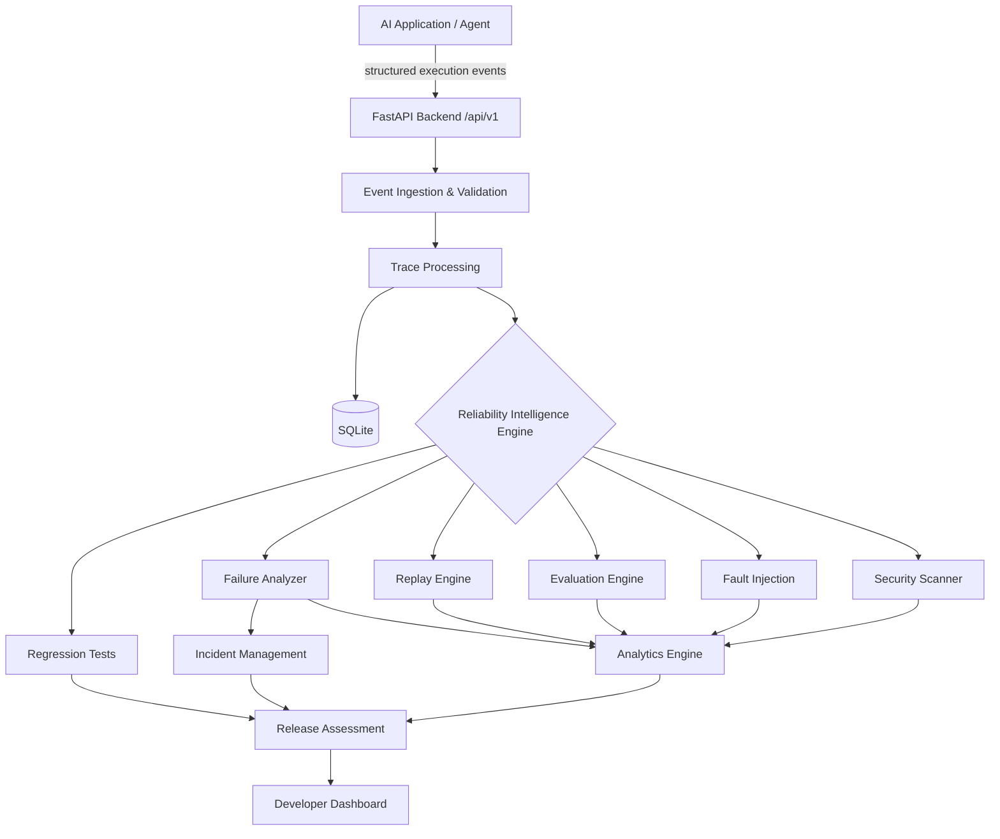
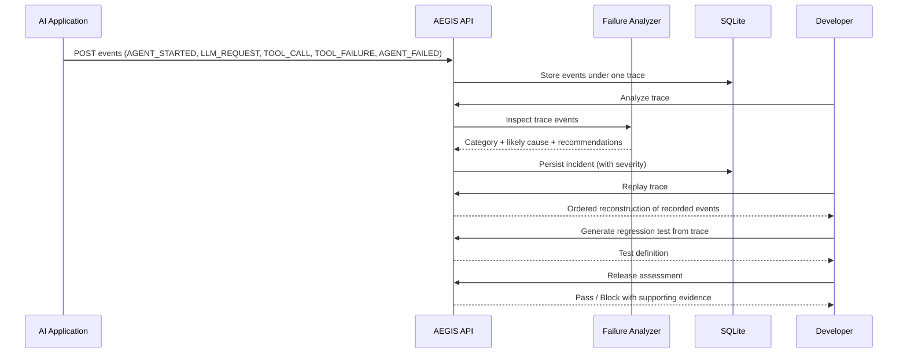
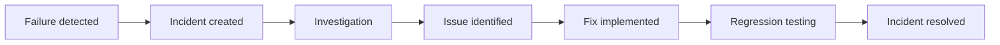

<div align="center">

# 🛡️ AEGIS

### AI Reliability, Observability & Engineering Platform

*Make AI applications more observable, testable, and reliable.*

**Observe → Investigate → Reproduce → Test → Evaluate → Improve → Release**


[Overview](#-overview) · [Features](#-features) · [Architecture](#-architecture) · [Quick Start](#-quick-start) · [API](#-api-reference) · [Status](#-project-status--honest-assessment) · [Roadmap](#-roadmap)

</div>

---

> **⚠️ Status: actively developed prototype.** Core tracing, analytics, failure analysis and heuristic evaluation have been exercised locally. Fault injection, regression-test execution and release-gate workflows still need verification. AEGIS is **not** production-validated. See the [honest assessment](#-project-status--honest-assessment).

---

## 📌 Table of Contents

- [Overview](#-overview)
- [The Problem](#-the-problem)
- [Features](#-features)
- [Architecture](#-architecture)
- [How a Failure Moves Through AEGIS](#-how-a-failure-moves-through-aegis)
- [Data Model](#-data-model)
- [Failure Taxonomy & Incidents](#-failure-taxonomy--incidents)
- [Quick Start](#-quick-start)
- [API Reference](#-api-reference)
- [Example Workflow](#-example-workflow)
- [Design Decisions & Trade-offs](#-design-decisions--trade-offs)
- [Project Structure](#-project-structure)
- [Testing](#-testing)
- [Project Status & Honest Assessment](#-project-status--honest-assessment)
- [Roadmap](#-roadmap)
- [Use Cases](#-use-cases)
- [FAQ](#-faq)
- [Contributing](#-contributing)
- [Author](#-author)

---

## 🔭 Overview

AEGIS is an **engineering layer around AI applications and agents**. It is not a chatbot and not an LLM provider.

The application being monitored sends structured execution events. AEGIS turns them into:

| You get | Instead of |
|---|---|
| **Traces**: ordered event sequences per execution | Scattered log lines |
| **Failure classification & incidents** | "It returned a wrong answer" |
| **Replayable records** of previous runs | Hard-to-reproduce one-off failures |
| **Regression tests** generated from real traces | The same bug returning after a prompt or model update |
| **Release gates** built on collected evidence | Shipping on gut feeling |

---

## 🧩 The Problem

An AI application is no longer one model call. A single run can involve:

```text
User input → Prompt construction → LLM inference → Tool selection
→ External API call → Retrieval / DB operation → Agent interaction
→ Response generation → Output validation
```

Every step is a potential failure point, and the user only sees the final answer.

**Concrete example.** A support agent asks an order API for a status. The API times out, the app retries, receives a partial response, and the model answers incorrectly. The team now needs to know:

- Did the model pick the wrong tool call, or did the API fail?
- Was the response incomplete?
- Did the timeout and retry logic behave correctly?
- Could this happen again after the next deployment?

| Gap | What AEGIS adds |
|---|---|
| Limited execution visibility | Structured trace explorer |
| Difficult failure investigation | Failure analysis + incidents |
| Reproduction challenges | Stored-event replay |
| Recurring failures | Regression tests from traces |
| Weak reliability testing | Fault-injection scenarios |
| Unclear response quality | Evaluation engine |
| Deployment uncertainty | Release gates & assessment |

---

## ✨ Features

### 1. Trace Explorer
Every execution is stored as an ordered sequence of events with event type, application ID, trace ID, timestamp, status, duration, error information and metadata. Includes application registration, event ingestion, trace listing, per-trace inspection and chronological reconstruction.

### 2. Failure Analysis & Root-Cause Investigation
A rule-based analyzer inspects a trace's events, identifies a likely failure category, orders related events, and produces investigation recommendations. *(It reports likely causes, not proven ones.)*

### 3. Incident Management
Failures become incidents with ID, related trace, category, severity, description, recommendations, status and creation time.

### 4. Trace Replay
Reconstructs a recorded execution step by step from stored events, with replay comparison against expected or recorded behaviour. *(Replay of stored events, not live re-execution. See [limitations](#known-limitations).)*

### 5. Regression-Test Generation
Turns a recorded trace into a structured test definition: expected agent start, expected tool events, recorded tool response, successful completion.

### 6. Fault Injection *(in progress)*
Controlled failure scenarios: LLM timeout, HTTP 503, HTTP 429, tool failure, and bounded artificial latency.

### 7. Response Evaluation
Local heuristic metrics: relevance, context relevance, context coverage, completeness, and unsupported-term indicators. No external API needed.

### 8. Prompt-Injection Scanning *(early version)*
Flags suspicious input patterns and instruction-manipulation indicators.

### 9. Analytics & Optimization Recommendations
Total events, success and failure counts, success rate, average and maximum duration, failure distribution, incident severity distribution, plus recommendations such as reviewing high-latency steps, repeated failures and excessive retries.

### 10. Release Gates & Assessment
Collects traces, failures, regression results, evaluation results and security findings, then applies explicitly configured rules to produce a **pass / block** signal.

---

## 🏗️ Architecture



**Five layers**

1. **Application integration**: the monitored app emits events (agent start, LLM request/response, tool call, API response, completion, failure).
2. **Ingestion & trace processing**: validate, associate with application and trace, persist.
3. **Reliability intelligence engine**: failure analyzer, replay, evaluation, fault injection, security, regression, release logic.
4. **Analytics & incident management**: statistics, classifications, incident records, summaries.
5. **Developer interface**: REST API and dashboard.

---

## 🔁 How a Failure Moves Through AEGIS



**Incident lifecycle**



---

## 🗃️ Data Model

An execution is a **trace**; a trace is an ordered list of **events**.

```text
TRACE: customer_support_001

1. AGENT_STARTED
2. LLM_REQUEST
3. LLM_RESPONSE
4. TOOL_CALL
5. TOOL_RESPONSE
6. AGENT_COMPLETED
```

Each event carries: event type, application identifier, trace identifier, timestamp, execution status, duration, error information and additional structured metadata.

**Illustrative event shape** (built from the fields above; check `/docs` for the exact schema):

```json
{
  "application_id": "support-agent",
  "trace_id": "customer_support_001",
  "event_type": "TOOL_FAILURE",
  "timestamp": "2026-01-01T10:00:03Z",
  "status": "error",
  "duration_ms": 1550,
  "error": "HTTP 503 from order service",
  "metadata": { "tool": "order_lookup" }
}
```

---

## 🚨 Failure Taxonomy & Incidents

| Category | Example |
|---|---|
| `LLM_TIMEOUT` | Model request exceeds allowed time |
| Service unavailable | External service returns HTTP 503 |
| Rate limit | Provider returns HTTP 429 |
| Authentication | Invalid credentials or authorization failure |
| Retrieval failure | Context retrieval fails |
| Tool failure | An external tool does not execute successfully |
| Unknown | Does not match a known classification |

| Severity | Meaning |
|---|---|
| 🔴 Critical | Potentially severe system disruption |
| 🟠 High | Significant application or workflow failure |
| 🟡 Medium | Noticeable functional degradation |
| 🟢 Low | Limited-impact issue |

---

## 🚀 Quick Start

**Requirements:** Python 3.10+ and pip.

```bash
# 1. Clone
git clone https://github.com/3407Naveen/AGES.git
cd AGES

# 2. Virtual environment
python -m venv venv
source venv/bin/activate          # Windows: venv\Scripts\activate

# 3. Install
pip install -r requirements.txt

# 4. Run
uvicorn app.main:app --reload
```

Then open:

- **Swagger UI:** http://127.0.0.1:8000/docs
- **ReDoc:** http://127.0.0.1:8000/redoc

> Adjust the repository URL or run command if your layout differs. The database is created locally on startup.

---

## 📡 API Reference

All endpoints are versioned under **`/api/v1`**. Exact routes and schemas live in the OpenAPI docs at `/docs`.

| Group | Purpose |
|---|---|
| Health | Backend availability |
| Applications | Register and retrieve applications |
| Events | Ingest execution events |
| Traces | List and inspect traces |
| Trace analysis | Investigate failures |
| Replay / Replay comparison | Reconstruct and compare recorded traces |
| Regression tests | Generate tests from traces |
| Fault injection | Controlled failure scenarios |
| Security | Prompt-injection scanning |
| Evaluations | Evaluate AI responses |
| Analytics | Execution metrics |
| Incidents | Manage incidents |
| Release gates | Release-related checks |
| Release assessment | Consolidated release evidence |

---

## 🧪 Example Workflow

1. **Register** your application.
2. **Send events** from your agent as it runs.
3. **Inspect the trace** to see the ordered sequence.
4. **Analyze the failure** to get a category, likely cause and an incident.
5. **Replay** the trace to reconstruct what happened.
6. **Generate a regression test** from that trace.
7. *(In progress)* **Inject faults** (timeouts, 429/503) to test dependency handling.
8. **Evaluate responses** against retrieved context.
9. **Check analytics** for success rate, latency and failure distribution.
10. **Run release assessment** to get a pass / block signal with evidence.

### Evaluation example

| | |
|---|---|
| Question | "Explain the purpose of trace replay." |
| Context | "Trace replay reconstructs a previously recorded execution sequence." |
| Response | "Trace replay reconstructs previously recorded application events." |

The evaluator checks overlap between response and context and whether expected information is covered.

---

## ⚖️ Design Decisions & Trade-offs

| Decision | Why | Trade-off |
|---|---|---|
| **Event-based traces** | One consistent model for any agent or LLM app | Apps must emit events (an SDK is on the roadmap) |
| **Rule-based failure analysis** | Transparent, deterministic, easy to extend | Reports *likely* causes; cannot prove causality |
| **Stored-event replay** | Safe: no repeated side effects, no extra LLM cost | Not a live re-execution of the original run |
| **Heuristic evaluation** | Runs locally with no external API | Word-overlap based, not semantic |
| **SQLite** | Zero setup for a prototype | Not suited to production volume |
| **Modular services** | Each reliability concern is isolated and replaceable | More modules to test and keep consistent |
| **Release gates need explicit rules** | Decisions stay auditable | Gates do not "guarantee" safe deploys on their own |

---

## 📁 Project Structure

```text
AEGIS/
├── app/
│   ├── main.py                  # FastAPI entry point, routing, CORS, lifecycle
│   ├── database.py              # SQLite setup
│   ├── models/                  # Request / data models
│   └── services/
│       ├── failure_analyzer.py
│       ├── evaluation/engine.py
│       ├── replay/engine.py
│       ├── fault_injection/engine.py
│       ├── security/
│       └── release/
├── tests/
├── requirements.txt
└── README.md
```

*Representative layout. Check it against the repository.*

---

## ✅ Testing

```bash
pytest
```

The backend has been exercised locally with recorded traces containing successful and failed executions. Broader automated test coverage is a Phase 1 roadmap item.

---

## 📊 Project Status & Honest Assessment

| Module | Status |
|---|---|
| FastAPI backend / SQLite | ✅ Implemented |
| Application registration | ✅ Implemented |
| Event ingestion, trace storage & inspection | ✅ Implemented and exercised |
| Trace analytics | ✅ Implemented and tested locally |
| Failure analysis | ✅ Implemented and exercised locally |
| Incident management | ✅ Implemented |
| Stored-event replay | ✅ Implemented |
| Replay comparison | ✅ Endpoint implemented |
| Response evaluation (heuristic) | ✅ Implemented and tested locally |
| Regression-test generation | 🟡 Endpoint implemented |
| Regression-test execution | 🟠 Needs further verification |
| Fault-injection engine | 🟠 Development started, needs verification |
| Prompt-injection scanning | 🟡 Endpoint implemented, accuracy not evaluated |
| Optimization recommendations | 🟡 Included, needs more scenarios |
| Release gates & assessment | 🟡 Endpoints implemented, needs integration testing |
| Production deployment | ⛔ Not established |

### Sample local test run

Development data, **not a benchmark or performance guarantee**:

| Metric | Result |
|---|---:|
| Recorded events | 11 |
| Successful traces | 2 |
| Failed traces | 1 |
| Trace success rate | 66.67% |
| Average event duration | 505.01 ms |
| Maximum event duration | 1,550 ms |
| High-severity incidents | 1 |
| Failure category identified | `LLM_TIMEOUT` |

### Known limitations

- **Replay reconstructs stored events.** It does not re-execute LLM calls, tools or real-world side effects.
- **Evaluation is heuristic.** It is not a reliable semantic evaluator and should not be treated as a hallucination detector.
- **Failure analysis is rule-based.** It does not establish definitive causes in every situation.
- **Security scanning is early.** Detection coverage and accuracy need dedicated evaluation before strong claims.
- **Text and event data only.** No audio or speech-specific signals yet.
- **SQLite is for local use.** Production deployment needs a different storage layer and authentication.

---

## 🗺️ Roadmap

- [ ] **Phase 1: Core foundation.** Strengthen event schemas, expand failure classifications, improve incident lifecycle, comprehensive automated tests
- [ ] **Phase 2: Replay & regression.** Controlled live replay with mock LLM and tool providers, regression-test execution, coverage and comparison reports
- [ ] **Phase 3: Advanced evaluation.** Embedding-based similarity, LLM-as-a-judge, groundedness and faithfulness checks, evaluation datasets, human review
- [ ] **Phase 4: Reliability & security.** Complete fault-injection testing, expanded prompt-injection tests, tool-call validation, multi-turn attack scenarios, reliability scoring
- [ ] **Phase 5: Production engineering.** PostgreSQL, authentication and RBAC, tenant isolation, scalable event processing, deployment automation, load-testing baselines
- [ ] **Phase 6: Platform expansion.** Instrumentation SDKs, LLM provider integrations, configurable monitoring rules, workflow orchestration, voice-specific signals (per-turn latency, speech-recognition errors)

---

## 🎯 Use Cases

| Domain | How AEGIS helps |
|---|---|
| **AI agent platforms** | Inspect tool calls and multi-step execution sequences |
| **Conversational & voice AI** | Trace failed tool or API calls during live conversations *(voice-specific signals planned)* |
| **RAG applications** | Execution visibility and evaluation across retrieval and generation |
| **AI automation systems** | Investigate failures across tasks that touch many services |
| **LLM-powered SaaS** | Give engineering teams visibility into behaviour and reliability |

*These are target areas, not a claim of existing integrations.*

---

## ❓ FAQ

**Is AEGIS an LLM or a chatbot?**
No. It is an engineering layer that observes and tests AI applications.

**Does replay call the LLM again?**
No. It reconstructs recorded events. Controlled live replay with mocks is on the roadmap.

**Can I rely on the evaluation score?**
Treat it as a heuristic signal. Semantic and LLM-based evaluation are planned.

**Is it production ready?**
No. It is a prototype, and the status table shows what has and has not been verified.

**Will it guarantee safe releases?**
No. Release gates apply rules you configure. They organize evidence; they do not guarantee outcomes.

---

## 🤝 Contributing

Feedback, issues and suggestions are welcome, especially on event schemas, failure categories and evaluation approaches.

1. Fork the repository
2. Create a branch: `git checkout -b feature/your-idea`
3. Commit and push your changes
4. Open a pull request describing the change and how you tested it

---

## 👤 Author

**Naveen S**: B.Tech Artificial Intelligence & Data Science, Chennai, India
Focus: AI Engineering · Backend Systems · AI Reliability · Developer Infrastructure

[GitHub](https://github.com/3407Naveen) · [LinkedIn](https://www.linkedin.com/in/naveen-s-003633314/) · 3407naveen@gmail.com

---

<div align="center">

**Observe every execution. Understand every failure. Reproduce important behaviour. Test before release. Improve continuously.**

</div>
